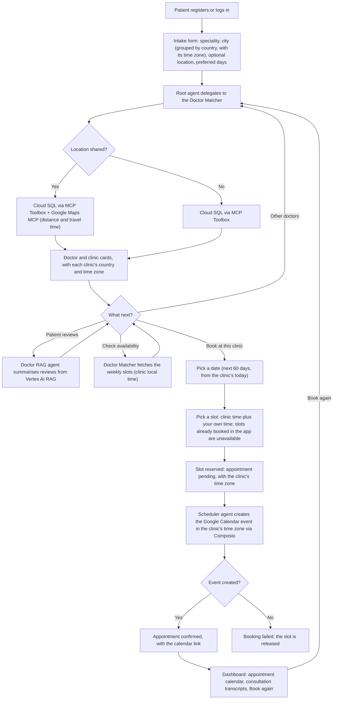
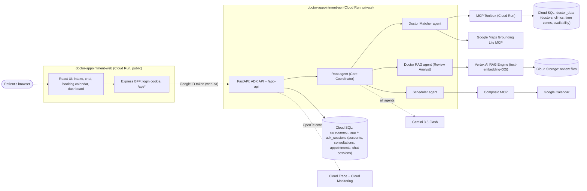

# Doctor Appointment Scheduler

## Project Overview

Doctor Appointment Scheduler is an AI-powered, multi-agent doctor appointment booking solution built to simplify the complete patient journey in a single conversational experience. Instead of forcing users to search across clinic portals, compare doctors manually, read reviews from separate sources, calculate travel time, check availability, and then book on another platform, this system brings all of those steps together through coordinated AI agents and MCP-based tool integrations. It helps users discover suitable doctors by specialization and city, evaluate options using clinic location and patient feedback, choose convenient time slots, and finally schedule the appointment directly on Google Calendar, making the overall process faster, smarter, and more user-friendly.

Patients sign in to a web app, describe what they need, and the agents search clinics in 170 cities across 44 countries. Every clinic has its own time zone. Slots are shown and booked in the clinic's local time, with the patient's own time alongside. Booked appointments, consultation transcripts and rebooking live on a personal dashboard.

## Live Demo

The application is deployed on Google Cloud Run:
[https://doctor-appointment-web-731638668879.asia-south2.run.app](https://doctor-appointment-web-731638668879.asia-south2.run.app)

## Demo Video

Check out the [demo video on Google Drive](https://drive.google.com/file/d/1crVf8UKEkUTxU_4_jolV2aocKHAVfUUn/view?usp=drive_link).

## Why This Project Matters

Most doctor discovery and appointment booking experiences are fragmented. Users often need to switch between multiple apps and websites just to answer a few basic questions:

- Which doctor matches my medical need?
- Which clinic is closest to me?
- How long will it take to reach there?
- What do other patients say about the doctor?
- Is the doctor available at my preferred time?
- How do I confirm the appointment quickly?

This project addresses that fragmentation by combining search, reasoning, review retrieval, route estimation, and scheduling into one unified AI-assisted workflow.

### Main Advantages

- End-to-end conversational booking experience instead of isolated search or booking steps
- Multi-agent architecture that separates coordination, doctor matching, review intelligence, and scheduling
- Grounded responses using structured data and retrieval instead of generic chatbot answers
- Better decision-making through doctor reviews, clinic details, and travel-time awareness
- Reduced user effort by directly creating the appointment in Google Calendar

### What Makes It Different

Unlike a typical healthcare chatbot or doctor directory, this solution is action-oriented. It does not stop at recommending doctors. It can pull doctor and clinic data, estimate distance and travel duration, retrieve grounded patient review insights, check available slots, and complete the booking workflow. Its biggest USP is that discovery, decision-making, and appointment scheduling happen in one intelligent flow without forcing the user to switch tools repeatedly.

## Features

- Doctor, clinic, and doctor availability search via Cloud SQL MCP, over 874 clinics in 170 cities across 44 countries and 12 specializations
- Time-zone aware booking: each clinic has an IANA time zone, slots are in clinic local time, the patient's own time is shown next to them, and the Google Calendar event is created in the clinic's zone
- Distance and travel time calculation from the user's location to the clinic via Google Maps MCP
- Doctor review discovery through a Vertex AI RAG pipeline
- Appointment scheduling through Google Calendar MCP
- Multi-agent orchestration using a root coordinator, doctor matcher, review agent, and scheduler agent
- Human-in-the-loop conversational refinement for comparing doctors, checking reviews, verifying slots, and confirming bookings
- A patient-facing React UI with a guided intake form, live agent activity, doctor cards, a time-slot grid and booking confirmation
- Patient accounts (register / log in / log out) with per-user isolation of consultations and appointments
- Calendar-based booking: pick a date on a month calendar, then a time slot in a pop-up; double-booking is prevented
- A personal dashboard with an appointment calendar, consultation transcripts and one-click rebooking of a past doctor

## User Interface

The patient-facing web app in [frontend/](frontend) is built with React, TypeScript, Vite and Tailwind CSS. It uses a healthcare look: clinical teal on a soft neutral canvas, with accessible contrast and a layout that works on phones, tablets and desktops.

- **Home, About and Contact pages.** A marketing home page explains the service, with **Log in** and **Register** on separate pages. The site footer links to About Us and Contact Us, and the contact address is a `mailto:` link that opens the default email app.
- **Accounts.** Registration stores first and last name, phone, email, current address and date of birth. The password must have at least 8 characters with an uppercase letter, a lowercase letter, a number and a special character; a live checklist ticks off each rule and the confirm field shows whether the passwords match.
- **Guided intake.** Pick a speciality and a city from a list grouped by country, which shows the city's time zone (the list starts on a city in your own time zone when there is one). Optionally share your location (pre-filled with your saved address, typed, or with "Use my current location"), and choose preferred days. The app turns this into the first message to the agents.
- **Consultation chat.** Responses stream in as they are generated and render markdown tables. Each reply is labelled with the agent that wrote it (Care Coordinator, Doctor Matcher, Review Analyst, Appointment Scheduler). A collapsible **agent activity timeline** shows each step, such as "Searching Cardiology in Kolkata · Cloud SQL" or "Calculating distance & travel time · Google Maps".
- **Live results panel**, built from the agents' tool results:
  - Doctor cards with experience and clinics, plus distance and travel time when a location was shared
  - A 7-slot availability grid per doctor, clinic and day
  - Appointment cards that move from *requested* to *confirmed*, with an "Open in Google Calendar" link
- **Calendar booking.** "Book at this clinic" opens a month calendar (next 60 days). Choosing a date opens a time-slot pop-up that combines the doctor's weekly schedule (fetched by the agent) with slots already booked through the app on that date. Dates and times are in the clinic's local time, and each slot also shows your own time when it differs. Confirming reserves the slot, then asks the scheduler agent to create the Google Calendar event in the clinic's time zone.
- **Dashboard.** Appointments on a month calendar with the doctor's name, status colours, details (with the clinic's local time and yours), recent consultations with their full transcripts, and **Book again**, which opens a new consultation with that doctor already selected so you only choose the clinic, date and time.
- **One-click actions.** "Patient reviews", availability checks and bookings all send ordinary chat messages to the root agent. The agents, tools and prompts are unchanged.
- **Persistent consultations.** Sessions live in Cloud SQL, so reloading the page restores the full conversation and results. Every message, agent reply and tool call is also logged per user, per login session and per consultation.
- **Secure logout.** Sessions are HttpOnly cookies revoked on the server at logout; signed-in pages and API responses are never cached, so the Back button can't show a signed-in page afterwards.

The UI derives everything from the ADK event stream ([frontend/src/lib/adkEvents.ts](frontend/src/lib/adkEvents.ts)), so live streaming and session restore share the same code.

## Technologies Used

This project uses a modular Google Cloud and MCP-first architecture so each part of the workflow is handled by the most appropriate managed service or tool integration.

- Google ADK for multi-agent orchestration and delegation
- Gemini 3.5 Flash for conversational reasoning and task coordination
- Google AI Studio (Gemini API) for the agents' model calls, or Vertex AI with `GOOGLE_GENAI_USE_VERTEXAI=true`
- Vertex AI RAG Engine for grounded retrieval over doctor review data
- `text-embedding-005` for review document embeddings
- Google Cloud SQL for structured doctor, clinic, and availability data
- MCP Toolbox for exposing Cloud SQL queries as MCP tools
- Google Maps Grounding Lite MCP for route, distance, and travel-time estimation
- Google Cloud Storage for storing doctor review documents used by the RAG pipeline
- Composio for Google Calendar MCP connectivity and OAuth-backed action execution
- FastAPI (via ADK's `get_fast_api_app`) for the backend API layer
- React 19 + TypeScript + Vite + Tailwind CSS + React Router for the patient-facing UI, served by a small Express 5 backend-for-frontend
- SQLAlchemy (async) for patient accounts, consultation logs and appointments, with Argon2 password hashing
- Cloud Run for three services: the public frontend, the private backend (linked by service-to-service ID-token auth) and the MCP Toolbox
- Cloud SQL (MySQL 8) for the doctor data, persistent ADK chat sessions, and patient accounts and appointments; Secret Manager for API keys and the DB password
- Cloud Trace (via ADK's OpenTelemetry spans) and Cloud Logging for tracing every agent step, LLM call, tool call and token count
- Cloud Monitoring (ADK's GenAI metrics via the Telemetry API) for a dashboard of token usage, LLM latency per response, and agent, tool and turn latency

### Why This Stack

- It cleanly separates reasoning, retrieval, search, and action execution
- It supports modular growth as new agents or tools are added
- It is suitable for real-world deployment because the app logic remains lightweight while managed cloud services handle scale, storage, and integrations
- It supports production-style extensibility for new cities, specialties, data sources, and scheduling integrations

## Process Flow Diagram



## Architecture Diagram



## Deployment

```text
Browser ──▶ doctor-appointment-web  (Cloud Run, public)
              React UI + Express BFF: /api/auth/*, /api/sessions, /api/chat (SSE),
              /api/appointments, /api/consultations  (HttpOnly session cookie)
                │  Google ID token (service account web-sa, roles/run.invoker)
                ▼
            doctor-appointment-api  (Cloud Run, private)
              FastAPI + Google ADK agents (service account agent-sa)
                ├─ Toolbox on Cloud Run ─▶ Cloud SQL (doctors, clinics, availability)
                ├─ Google Maps Grounding Lite MCP
                ├─ Vertex AI RAG Engine (doctor reviews)
                ├─ Composio ─▶ Google Calendar
                ├─ ADK sessions ─▶ Cloud SQL database adk_sessions
                ├─ /app-api: accounts, login sessions, consultation logs,
                │  appointments ─▶ Cloud SQL database careconnect_app
                └─ OpenTelemetry ─▶ Cloud Trace (spans) · Cloud Monitoring (metrics)
```

Run the deploy scripts from the repo root, in this order. They read the repo's `.env` and need the [Google Cloud CLI](https://cloud.google.com/sdk/docs/install) signed in (`gcloud auth login`).

**Windows PowerShell:**

```powershell
.\deploy\setup_gcp.ps1          # one-time: APIs, sessions + app DBs, secrets, web-sa, trace + metrics access
.\deploy\deploy_backend.ps1     # private API service (root Dockerfile)
.\deploy\deploy_frontend.ps1    # public web service (frontend/Dockerfile) + invoker binding
.\deploy\setup_monitoring.ps1   # Cloud Monitoring dashboard + consultations metric
```

- Add `-DryRun` to any of them to print the commands that would change something, without running them.
- If PowerShell says running scripts is disabled, run `Set-ExecutionPolicy -Scope Process -ExecutionPolicy Bypass` first. It only applies to that PowerShell window.
- Don't run `bash deploy/...` from PowerShell. On Windows, `bash` there usually starts WSL, which has neither your `gcloud` sign-in nor this checkout's path.

**macOS, Linux, Cloud Shell or Git Bash:**

```bash
bash deploy/setup_gcp.sh
bash deploy/deploy_backend.sh
bash deploy/deploy_frontend.sh
bash deploy/setup_monitoring.sh
```

See [Project_Steps.md, Phase 8](Project_Steps.md#phase-8----cloud-run-deployment) for details, and Phase 9 for local development.

### Observability

- **Dashboard (Cloud Monitoring):** *Doctor Appointment Scheduler - Agents and LLM*, created by `deploy/setup_monitoring.ps1` (or `.sh`). It shows consultations, total tokens (by input/output and by agent), average tokens per consultation, LLM latency per response (average, p50/p95, by agent), chat turn latency, tool latency and the share of cached input tokens. It is built from ADK's OpenTelemetry metrics and a log-based count of new consultations.
- **Traces (Cloud Trace):** one trace per chat message in [Trace Explorer](https://console.cloud.google.com/traces/explorer), showing each agent handoff, Gemini call (with token counts) and tool call, with timings. Filter on `gen_ai.conversation.id` to see one conversation. Prompts and responses are left out of traces by default because conversations contain health details.

See [Project_Steps.md, Phase 10](Project_Steps.md#phase-10----observability-cloud-trace-cloud-monitoring-and-logs) for how it's wired, settings, the metrics and PromQL queries behind the dashboard, logs, and per-conversation token usage.

## Installation and Setup

The complete environment setup, Google Cloud configuration, database creation, MCP setup, RAG pipeline preparation, Maps integration, and Google Calendar integration steps are documented in [Project_Steps.md](Project_Steps.md).

### Requirements

- Python 3.12 (the backend image uses `python:3.12-slim`)
- Node.js 22 or later (the frontend image uses `node:22-alpine`)
- [Google Cloud CLI](https://cloud.google.com/sdk/docs/install), signed in with `gcloud auth login` and `gcloud auth application-default login`
- A Google Cloud project with billing enabled
- API keys and accounts: a Google AI Studio (Gemini API) key, a Google Maps API key, and a [Composio](https://composio.dev) account with Google Calendar connected
- Git Bash on Windows, only for the bash-only data scripts (`populate_data.sh`, `upload_reviews.sh`)

### Dependencies

| Part | File | Main packages |
| --- | --- | --- |
| Agents | [agents/requirements.txt](agents/requirements.txt) | `google-adk`, `google-cloud-aiplatform` (Vertex AI RAG), `toolbox-adk`, `composio`, `composio_google_adk`, `python-dotenv` |
| Backend API | [backend/requirements.txt](backend/requirements.txt) (includes the agents' file) | `google-adk[db,mcp]==2.14.1`, `uvicorn`, `aiomysql`, `aiosqlite`, `argon2-cffi`, `email-validator`, `tzdata`, OpenTelemetry exporters for Cloud Trace and Cloud Monitoring |
| Backend tests | [backend/requirements-dev.txt](backend/requirements-dev.txt) | `pytest`, `pytest-asyncio`, `httpx` |
| Frontend | [frontend/package.json](frontend/package.json) | React 19, React Router 7, Vite 8, Tailwind CSS 4, TypeScript 5.9, Vitest; the server uses Express 5, `google-auth-library`, `helmet`, `express-rate-limit` |

The root [requirements.txt](requirements.txt) installs everything the backend and agents need.

### Setup Summary

1. Create and configure a Google Cloud project.
2. Enable the required Google Cloud APIs such as Vertex AI, Cloud SQL, Cloud Run, Cloud Storage, IAM, and Maps services.
3. Create the required service account and assign the necessary IAM roles.
4. Create the Cloud SQL instance and database.
5. Generate the synthetic dataset from [clinics_list.csv](data_creation_artifacts/clinics_list.csv) with `python data_creation_artifacts/generate_data.py` and `python data_creation_artifacts/generate_doctor_reviews.py`, then load it with [data/seed_sql/populate_data.sh](data/seed_sql/populate_data.sh). See [synthetic_data_creation_strategy.md](data_creation_artifacts/synthetic_data_creation_strategy.md).
6. Deploy the Cloud SQL MCP Toolbox with [`agents/tools/cloudsql_mcp/tools.yaml`](agents/tools/cloudsql_mcp/tools.yaml).
7. Upload the doctor review files to Google Cloud Storage and import them into the Vertex AI RAG corpus with [deploy/upload_reviews.sh](deploy/upload_reviews.sh) (see [gcs_upload_guide.md](gcs_upload_guide.md)).
8. Configure Google Maps MCP for route and travel-time support.
9. Configure Composio and connect Google Calendar for appointment scheduling.
10. Create the `.env` file ([Project_Steps.md, Phase 4](Project_Steps.md#phase-4----setting-up-cloud-sql-mcp)), install the Python dependencies, and run the backend locally:

    ```powershell
    python -m venv venv
    .\venv\Scripts\Activate.ps1          # bash: source venv/bin/activate
    pip install -r requirements.txt
    uvicorn backend.main:app --port 8000
    ```

11. Run the React UI locally (`cd frontend`, `npm install`, `npm run dev`), then open <http://localhost:5173>.
12. Run the tests: `pip install -r backend/requirements-dev.txt` then `pytest backend`, and `npm test` in `frontend`.
13. Deploy to Cloud Run with the scripts in [deploy/](deploy): `.ps1` for Windows PowerShell, `.sh` for bash (see [Deployment](#deployment)).

### Core Project References

- Setup guide: [Project_Steps.md](Project_Steps.md)
- Review upload guide: [gcs_upload_guide.md](gcs_upload_guide.md)
- Backend API entrypoint: [backend/main.py](backend/main.py)
- React UI: [frontend/src/App.tsx](frontend/src/App.tsx)
- Frontend server (BFF + ID-token proxy): [frontend/server/index.mjs](frontend/server/index.mjs)
- Deployment scripts: [deploy/](deploy) (PowerShell `.ps1` and bash `.sh` versions of each)
- Root agent: [agents/root_agent/agent.py](agents/root_agent/agent.py)
- Doctor matcher agent: [agents/doctor_matcher/agent.py](agents/doctor_matcher/agent.py)
- Review agent: [agents/doctor_rag_agent/agent.py](agents/doctor_rag_agent/agent.py)
- Scheduler agent: [agents/scheduler_agent/agent.py](agents/scheduler_agent/agent.py)

## Repository Highlights

- Synthetic global dataset: 874 clinics at real addresses in 170 cities across 44 countries, each with its IANA time zone, plus 6,749 doctors with common local names, 12 specializations and about 62,000 weekly schedules (one per doctor, clinic and weekday, each with seven slots from 10 AM to 5 PM clinic time)
- Review corpus with one review file per doctor (6,749 files) for RAG-based doctor feedback retrieval
- Multi-agent orchestration using Google ADK
- MCP integrations for Cloud SQL, Google Maps, and Google Calendar
- Deployment-oriented Google Cloud architecture for scaling beyond the prototype stage
